<div align="center">

<!-- Animated Tron Light Cycle Banner -->


<!-- Animated Typing -->
<a href="https://git.io/typing-svg"></a>


</div>

## `// IDENTITY DISC`

```javascript
const gridRunner = {
    handle: "jmlake569",
    sector: "The Digital Frontier",
    class: "Program // Builder // Operator",
    directives: [
        "Deploy autonomous AI agents",
        "Architect algorithmic trading systems",
        "Automate everything between mind and machine"
    ],
    stack: ["AI/ML", "Crypto", "Cloud", "Containers", "APIs"],
    philosophy: "The future doesn't wait. Neither do I.",
    status: "⚡ ACTIVE ON THE GRID"
};
```

I build systems that work while I sleep — AI agents that think, algorithms that trade, and infrastructure that scales. The future belongs to those who code it.

---

## `// CORE DIRECTIVES`

<table>
<tr>
<td width="50%">

### `> AGENTIC AI`
```
██████████████████████░░ 92%
```
Autonomous agents that reason, decide, and execute without human intervention.

</td>
<td width="50%">

### `> ALGO TRADING`
```
████████████████████░░░░ 85%
```
Algorithmic systems that analyze markets and execute at machine speed.

</td>
</tr>
<tr>
<td width="50%">

### `> AUTOMATION`
```
████████████████████████ 100%
```
If it runs twice, it gets scripted. If it runs daily, it runs itself.

</td>
<td width="50%">

### `> INFRASTRUCTURE`
```
██████████████████████░░ 90%
```
Containers, clouds, APIs — the backbone of the digital frontier.

</td>
</tr>
</table>

---

## `// TECH STACK`

<div align="center">

| Category | Technologies |
|:--------:|:-------------|
| **Cloud** |    |
| **Containers** |    |
| **AI/ML** |    |
| **Crypto** |    |
| **Languages** |    |

</div>

---

## `// GRID STATISTICS`

<div align="center">


</div>

---

## `// ACTIVE PROGRAMS`

```
┌────────────────────────────────────────────────────────────────────┐
│  STATUS        PROGRAM                                  PRIORITY   │
├────────────────────────────────────────────────────────────────────┤
│  [RUNNING]     Autonomous AI Agent Framework            ██████████ │
│  [RUNNING]     Algorithmic Trading Engine               █████████░ │
│  [ACTIVE]      Cloud Infrastructure Automation          ████████░░ │
│  [ACTIVE]      DeFi Protocol Integration                ███████░░░ │
│  [QUEUED]      Real-time Market Data Pipeline           ██████░░░░ │
└────────────────────────────────────────────────────────────────────┘
```

---

## `// TRANSMISSION CHANNELS`

<div align="center">

[](https://linkedin.com/in/YOUR_LINKEDIN)
[](https://twitter.com/YOUR_TWITTER)
[](mailto:your@email.com)

</div>

---

<div align="center">

```
"The Grid. A digital frontier. I tried to picture clusters of information
as they moved through the computer. Ships, motorcycles. With the circuits
like freeways. I kept dreaming of a world I thought I'd never see.
And then, one day... I got in."
```

<!-- Footer Banner -->


### `> END OF LINE`

</div>
